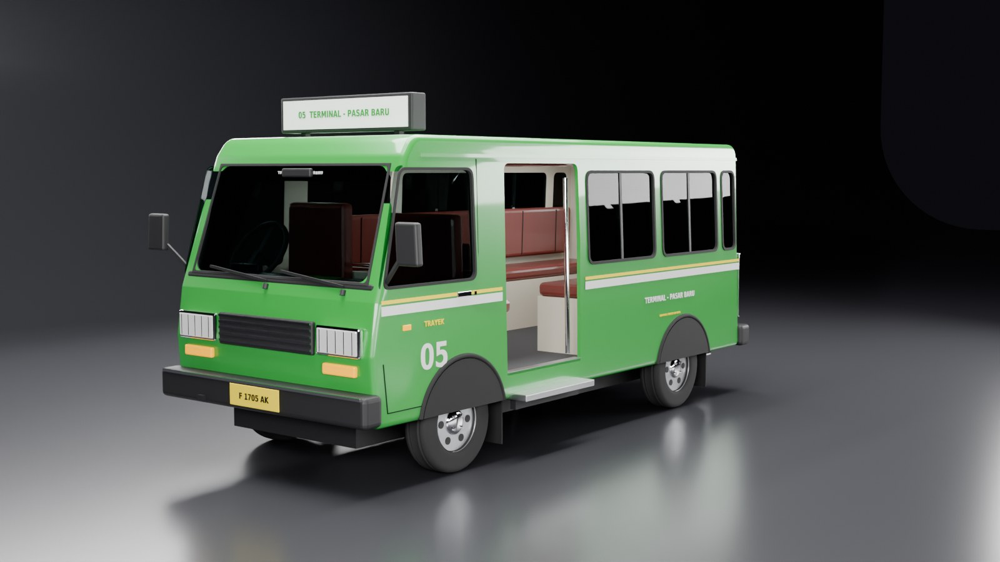
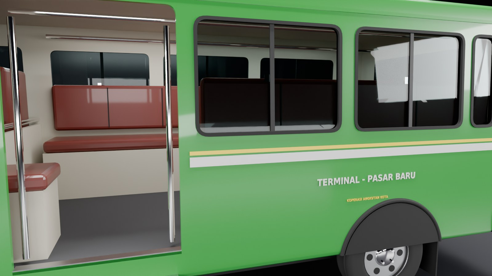

# Angkot detail tinggi

Angkot hijau trayek 05 sebagai model 3D detail, untuk gambar adegan, sampul, atau materi promosi.
Model ini **tidak dipakai mini-game nyetir**: game tetap memakai `assets/models/angkot*.glb` yang ringan.




## Isi

- `angkot.blend`: file Blender lengkap (dibuat dengan Blender 5.3), 196 mesh, ±134 ribu segitiga. Berisi lantai studio, lampu,
  dan kamera `Cam_FrontLeft`, `Cam_SideLeft`, `Cam_RearLeft`, `Cam_Front`, `Cam_Doorway`.
- `angkot.glb`: model yang sama untuk web atau three.js.
- `render/`: lima render Cycles, satu per kamera.

Minibus kabin depan tanpa lambang merek. Setir kanan, pintu penumpang terbuka di kiri, jok memanjang berhadapan di belakang.
Depan menghadap −X, atas +Z.

## Membuat ulang

```
pip install bpy
npm run angkot-detail        # ±1 menit, menimpa angkot.blend dan angkot.glb
```

Skripnya `tools/blender/angkot/build.py`. `OUT=<folder>` mengganti tempat hasil, `FONT=<file .ttf>` mengganti huruf tulisan
(bawaan DejaVu Sans Condensed Bold di `/usr/share/fonts/truetype/dejavu/`).

Render ulang satu kamera memakai skrip karakter:

```
python3 tools/blender/karakter/render.py art/angkot/angkot.blend Cam_FrontLeft hasil.png 128 100 1600 900
```
