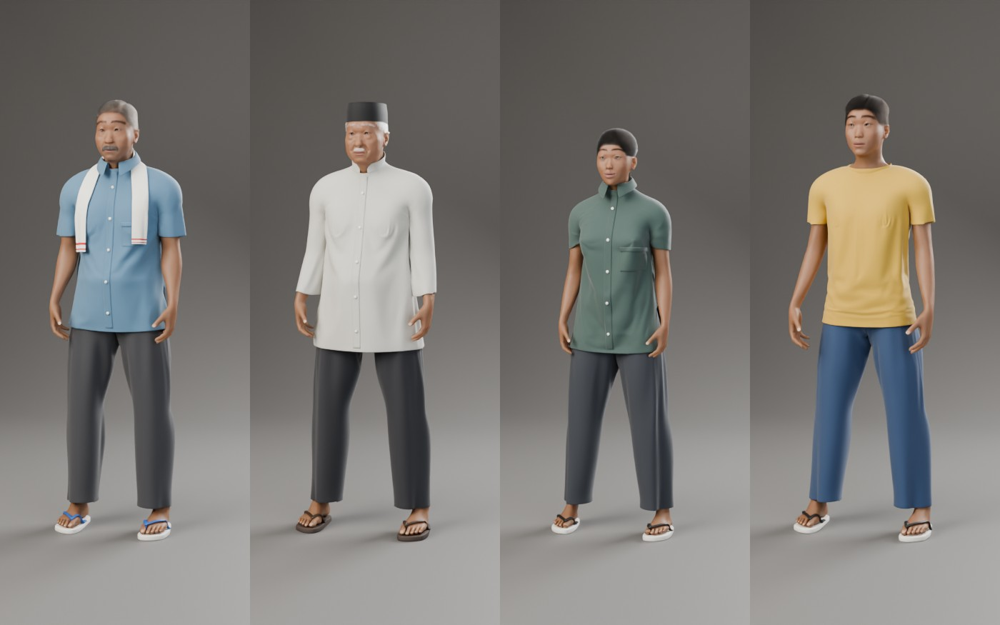
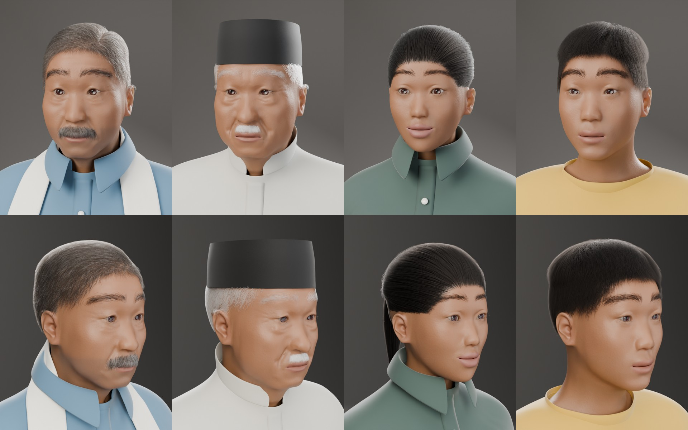

# Karakter detail tinggi

Empat tokoh cerita Narik sebagai model 3D realistis, untuk gambar adegan, potret dialog, atau materi promosi.
Model ini **tidak dipakai mini-game nyetir**: game tetap memakai `assets/models/orang.glb` yang ringan.




| Tokoh | File | Ciri |
|---|---|---|
| Mang Ujang | `ujang` | Sopir senior. Rambut belah samping beruban, kumis, kemeja biru, handuk kecil di bahu, sandal jepit |
| Haji Sobari | `sobari` | Juragan saingan. Peci hitam, rambut dan kumis putih, baju koko putih, sandal kulit |
| Teh Rina | `rina` | Montir. Rambut hitam dikuncir, kemeja kerja hijau tua |
| Dimas | `dimas` | Adik pemain. Rambut pendek berponi, kaus kuning, celana jin |

## Isi

- `blend/<nama>.blend`: file Blender lengkap (dibuat dengan Blender 5.3). Tekstur sudah dibundel. Berisi studio, lampu, dan
  kamera `Cam_Full`, `Cam_Bust`, `Cam_Face`, `Cam_Head34`, `Cam_HeadBack`, `Cam_Eyes`, `Cam_Back`, `Cam_Side`, `Cam_Hand`, `Cam_Feet`.
- `glb/<nama>.glb`: badan, pakaian, dan mata untuk web atau three.js. **Helai rambut, alis, kumis, dan bulu mata tidak
  ikut**, karena berupa Curves yang tidak diekspor ke GLB.
- `render/`: hasil render Cycles.

Tiap karakter ±350 ribu poligon. Badan di balik baju utuh, hanya disembunyikan dua modifier `Mask_tutup_*` pada objek `Badan`.

## Membuat ulang

```
pip install bpy scipy pillow
sh tools/blender/karakter/ambil_data.sh              # sekali saja, ±90 MB
CHAR=ujang python3 tools/blender/karakter/build.py   # ujang | sobari | rina | dimas, ±3 menit per karakter
python3 tools/blender/karakter/render.py art/karakter/blend/ujang.blend Cam_Face ujang.png
```

`NOSIM=1` melewati simulasi kain (±10 detik), berguna saat mengutak-atik wajah atau rambut.
Karakter baru ditambah di kamus `CHARS` di `build.py`: umur, otot, berat, morf wajah, warna kulit, gaya rambut
(`crop`, `fringe`, `pony`), dan jenis baju (`kemeja`, `kerja`, `koko`, `kaos`).

## Yang belum bagus

- Kulit masih prosedural dan terlihat mulus seperti lilin; belum ada tekstur foto.
- Mata terlihat abu kebiruan dari samping karena pantulan kornea.
- Garis rambut Teh Rina terlalu tegas di dahi dan bertakik di tengkuk. Mulut Dimas sedikit terbuka.
- Keempat wajah berasal dari satu mesh dasar, jadi masih terasa mirip.
- Belum ada rig: pose sudah dikunci, belum bisa dianimasikan.
- Pose keempatnya sama, lengan sedikit terbuka supaya kain tidak tersangkut di tangan saat simulasi.

## Sumber dan lisensi

Mesh dasar, morf, bobot rig, dan tekstur topeng kulit dari [MPFB2](https://github.com/makehumancommunity/mpfb2);
model dan tekstur mata dari [MakeHuman](https://github.com/makehumancommunity/makehuman). Keduanya aset CC0.
Pakaian, rambut, material, dan pose dibuat skrip di `tools/blender/karakter/`.
