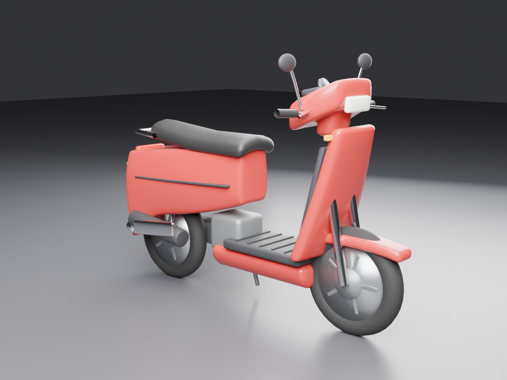

# Motor detail tinggi

Skuter matic tanpa merek, dimodelkan prosedural di Blender (`tools/blender/motor/build.py`, ±1 menit, `npm run motor-detail`).
±28 ribu segitiga: tameng kaki melengkung, batok lampu, dek berkaret, bodi belakang meruncing, jok, velg palang lima,
garpu teleskopik, knalpot dengan pelindung krom, spion, sein, lampu belakang, pelat.

- `motor.blend`: file Blender dengan lantai studio, lampu, dan kamera `Cam_DepanKanan`, `Cam_Samping`, `Cam_BelakangKiri`.
- `motor.glb`: model yang sama untuk web.
- `render/`: tiga render Cycles.

Depan +Y, atas +Z, tanah z = 0 (sama dengan aset game). Material `Cat` = warna bodi.

Versi game dibuat `tools/blender/motor/ringan.py`: `motor_parkir.glb` (±3.600 segitiga) dan `motor.glb` (±6.500 segitiga,
dengan pengendara Dimas yang didudukkan memakai kerangka tokoh ringan, plus helm). Cat = penanda CAT, baju pengendara =
penanda KEDUA (jaket), helm = penanda KETIGA, jadi warnanya diganti per motor di `drive3d.js`.
