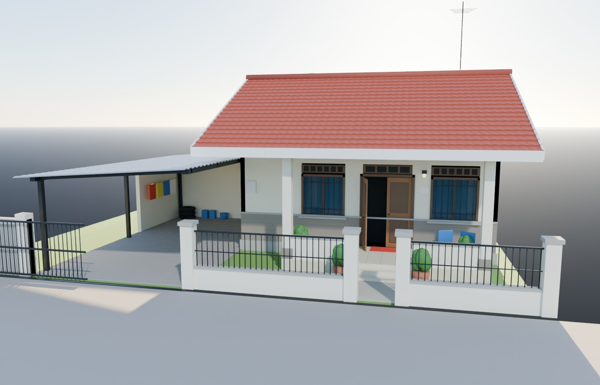
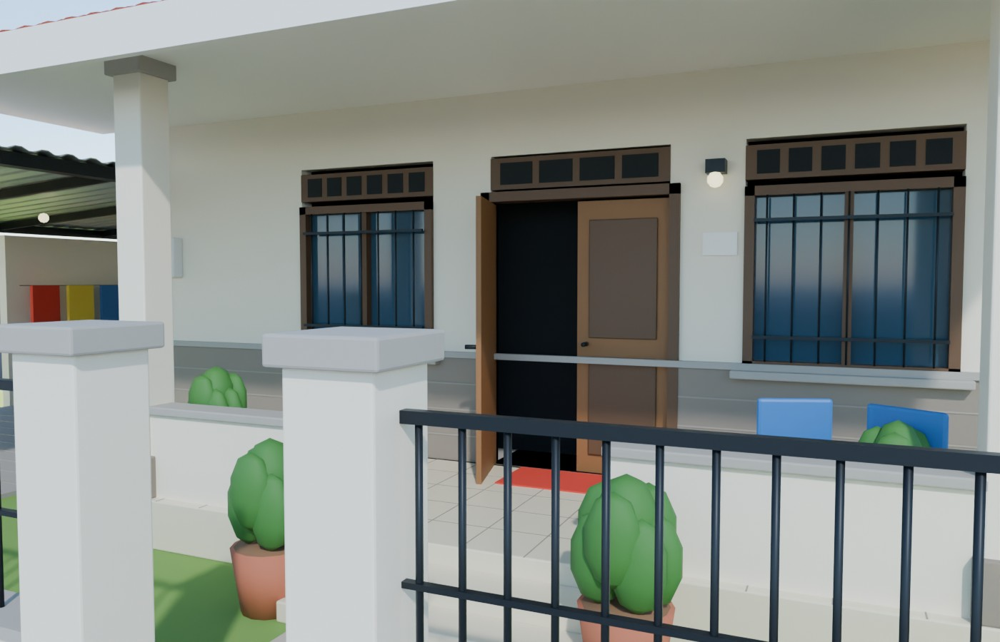
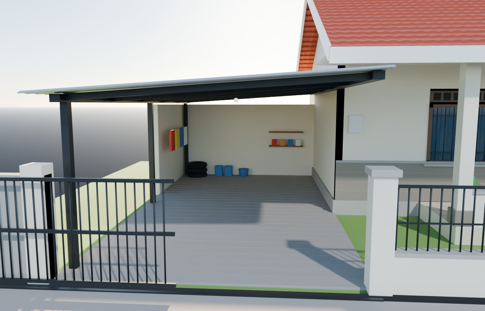

# Rumah sopir detail

Rumah keluarga di cerita: rumah kampung dengan teras dan garasi samping tempat Si Ijo. Dimodelkan prosedural di Blender
(`tools/blender/rumah/build.py`, `npm run rumah-detail`), ±39 ribu segitiga, 387 mesh.

Isi: atap pelana genteng berundak dan bergelombang dengan bubungan dan lisplang, dinding plester dengan bawahan batu alam,
jendela berkusen kayu dengan kaca, gorden, teralis, ambang, dan lubang angin; pintu kayu dua daun berpanel (satu terbuka),
teras berlantai keramik dengan tiang, tembok rendah, anak tangga, kursi plastik, meja, pot tanaman, keset, sandal, lampu,
meteran listrik; garasi berkanopi spandek dengan tiang besi, conblock, ban bekas, jeriken, ember, rak kaleng, jemuran;
toren air di menara besi, antena TV; pagar tembok rendah berjeruji dengan pilar, pintu pagar kecil, dan gerbang geser.

Muka rumah menghadap -Y, atas +Z, tanah z = 0. Titik penting untuk game (pintu, parkir, gerbang, lampu) ada di custom
property `titik` objek `Dinding_kiri`.

Versi game `assets/models/rumah_sopir.glb` (±7.700 segitiga) dibuat `tools/blender/rumah/ringan.py` dengan `DETAIL=0`
(genteng tanpa gelombang per keping; di game gelombangnya dari tekstur detail 'genteng'). Mesh `lampu` (bola lampu) dan
`kanopi` (atap spandek, tembus pandang di adegan rumah) dipisah.
